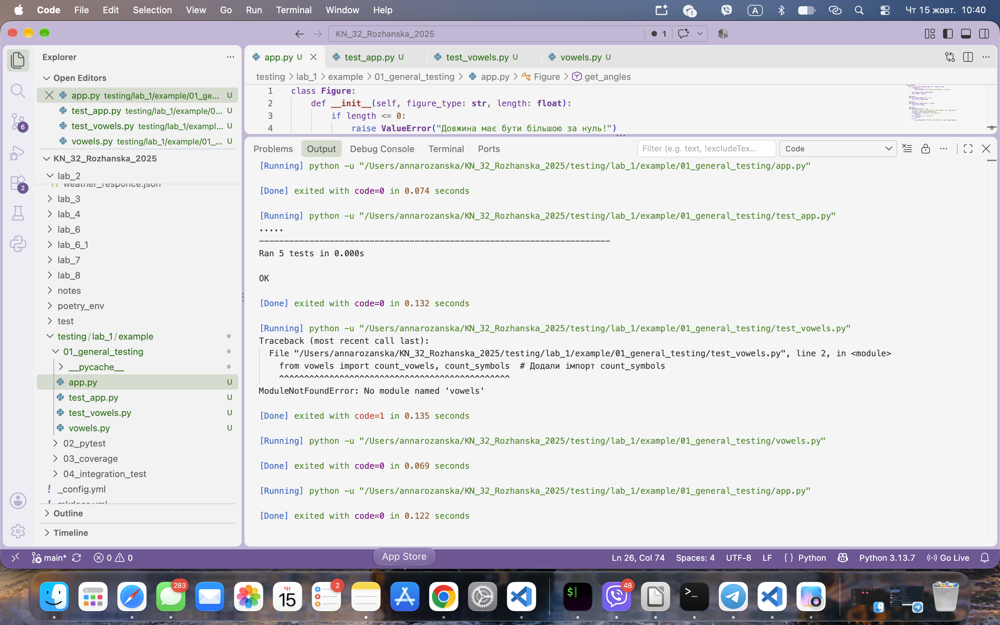
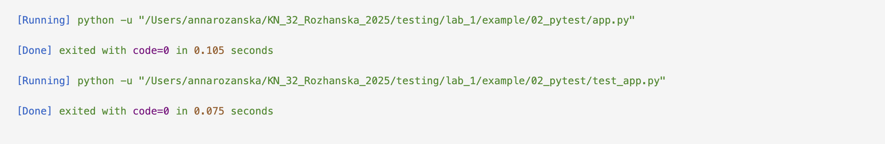
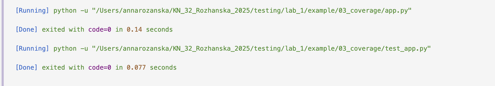
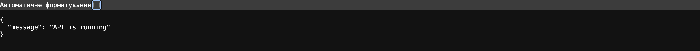

# Звіт до роботи

## Тема: Тестування

## Мета роботи: Дізнатись про види тестування, а також як і коли ними користуватись.

---

### Виконання роботи

#### 1. Unit testing (`unittest`)
* **Папка:** `01_general_testing`
* **Файли:** `app.py` та `test_app.py`
* **Результат:** Passed
* **Висновок:** Навчились користуватись класичними unit-тестами.


#### 2. Testing by library `pytest`
* **Папка:** `02_pytest`
* **Файли:** `app.py` та `test_app.py`
* **Результат:** Passed
* **Висновок:** Навчились користуватись бібліотекою `pytest`.


#### 3. Code coverage
* **Папка:** `03_coverage`
* **Файли:** `app.py` та `test_app.py`
* **Результат:** Passed
* **Висновок:** Навчились користуватись бібліотекою `coverage`.


#### 4. Integration testing
* **Папка:** `04_integration_tests`
* **Файли:** `app.py` та `test_app.py`
* **Результат:** Passed
* **Висновок:** Навчились користуватись інтеграційним методом тестування.

---

### Реалізований код та тести

#### `app.py`
```python
class Figure:
    def __init__(self, figure_type: str, length: float):
        if length <= 0:
            raise ValueError("Довжина має бути більшою за нуль!")
        
        self.figure_type = figure_type
        self.length = length

    @property
    def get_figure_type(self) -> str:
        return self.figure_type

    @property
    def get_figure_length(self) -> float:
        return self.length

    @property
    def get_angles(self) -> int:
        """Метод, який повертає кількість кутів залежно від типу фігури."""
        fig_type = self.figure_type.lower()
        if fig_type in ["квадрат", "прямокутник"]:
            return 4
        elif fig_type in ["трикутник"]:
            return 3
        else:
            raise ValueError(f"Невідомий тип фігури: {self.figure_type}")
```

#### `test_app.py`
```python
import pytest
from app import Figure

def test_triangle_type():
    triangle = Figure("трикутник", 4)
    assert triangle.get_figure_type == "трикутник"

def test_invalid_length():
    with pytest.raises(ValueError):
        Figure("квадрат", 0)
```

---
### Висновок:


-  :question: Що зроблено в роботі;

*AI агенти*
- :question: Чи досягнуто мети роботи;

*Так*
- :question: Які нові знання отримано;

*Навчилася створювати AI агентів*
- :question: Чи вдалось відповісти на всі питання задані в ході роботи;

*Так*
- :question: Чи вдалося виконати всі завдання;

*Так*
- :question: Чи виникли складності у виконанні завдання;

*НІі*
- :question: Чи подобається такий формат здачі роботи (Feedback);

*Так*
- :question: Побажання для покращення (Suggestions);

*Побажань не має, перепрошую, що із запізненням!*


---

