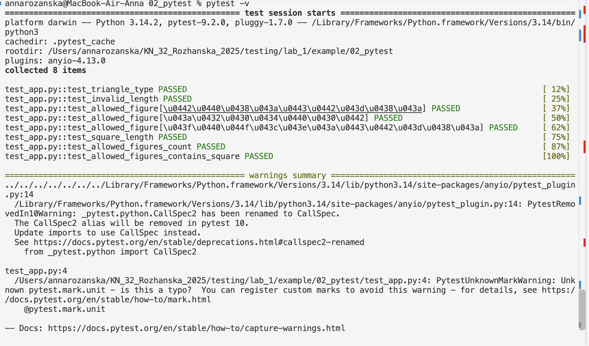

# Звіт до роботи

## Тема: Тестування з бібліотекою pytest

## Мета роботи: Ознайомитися з використанням бібліотеки pytest для створення юніт-тестів, вивчити її основні можливості (параметризація, фікстури, маркери) та навчитися тестувати обробку винятків і функціональність програмного коду.

---

### Виконання роботи

#### 1. Встановлення pytest
* **Команда:** `pip install pytest`
* **Опис:** Встановили фреймворк тестування `pytest` у віртуальне середовище.

#### 2. Запуск тестів та результати
* **Папка:** `02_pytest`
* **Файли:** `app.py` та `test_app.py`
* **Результат:** Passed
* **Висновок:** Опанували синтаксис `pytest`, використання перевірок через `assert` та винятків `pytest.raises`.


#### 3. Запуск за маркером та прапорці
* **Маркер:** `pytest -m unit -v` (виконання лише позначених юніт-тестів)
* **Аналіз помилок:** Використання прапорців `pytest -x --tb=short` дозволяє зупинити запуск після першої помилки та одержати скорочений вивід.

---

### Реалізований код та тести

#### `app.py`
```python
def count_vowels(text: str) -> int:
    """Рахує кількість голосних літер (українських та англійських) у рядку."""
    if not isinstance(text, str):
        raise TypeError("Аргумент має бути рядком")
    
    vowels = "аеєиіїоуюяaeiouyАЕЄИІЇОУЮЯAEIOUY"
    count = 0
    for char in text:
        if char in vowels:
            count += 1
    return count

def count_symbols(text: str) -> int:
    """Повертає загальну кількість символів у рядку."""
    return len(text)


---
### Висновок:


-  :question: Що зроблено в роботі;

*AI агенти*
- :question: Чи досягнуто мети роботи;

*Так*
- :question: Які нові знання отримано;

*Навчилася створювати AI агентів*
- :question: Чи вдалось відповісти на всі питання задані в ході роботи;

*Так*
- :question: Чи вдалося виконати всі завдання;

*Так*
- :question: Чи виникли складності у виконанні завдання;

*НІі*
- :question: Чи подобається такий формат здачі роботи (Feedback);

*Так*
- :question: Побажання для покращення (Suggestions);

*Побажань не має!*

---

