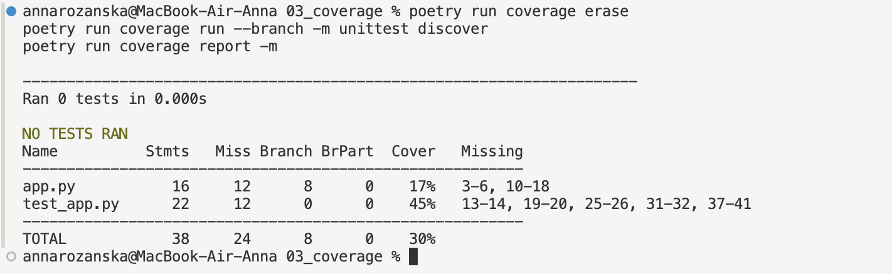
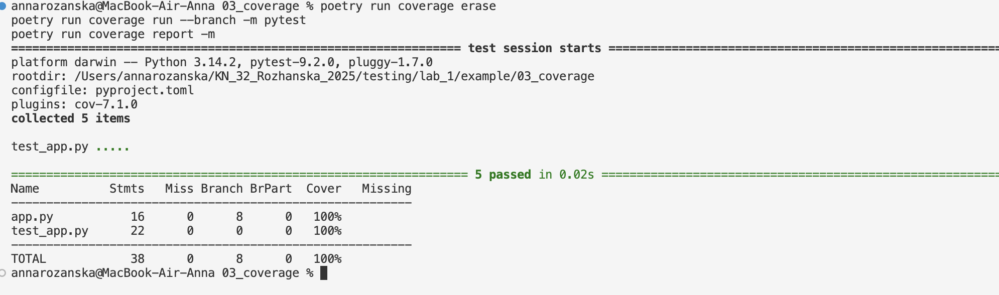
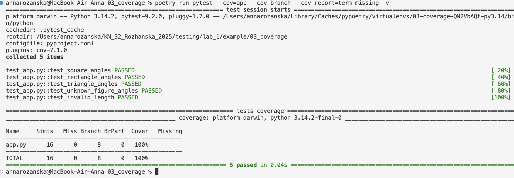
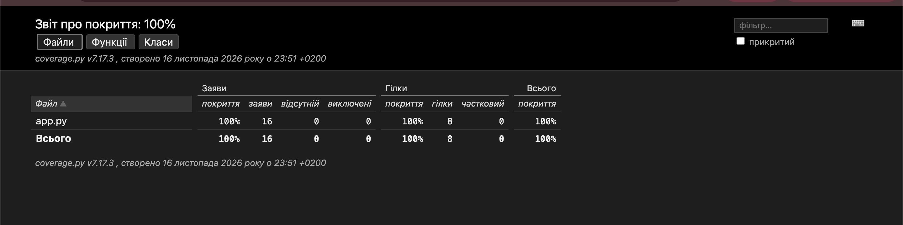
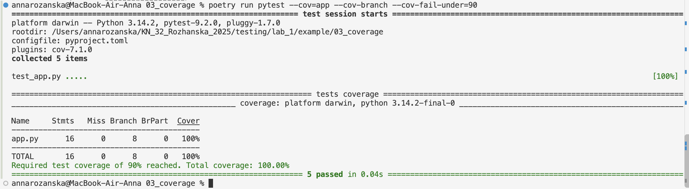
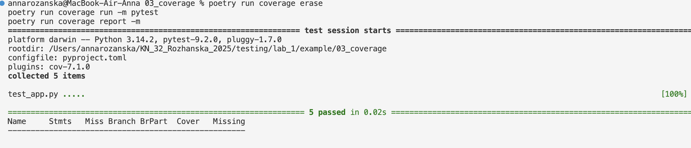

# Звіт до роботи

## Тема: Вимірювання покриття коду (Code Coverage) за допомогою coverage.py та pytest-cov

## Мета роботи: Навчитися вимірювати покриття рядків (line coverage) та розгалужень (branch coverage) програмного коду, налаштовувати конфігурацію інструментів аналізу покриття, генерувати звіти у різних форматах (термінал, HTML, XML) та розуміти обмеження метрик покриття коду.

---

### Виконання роботи

#### 1. Встановлення інструментів та базовий запуск тестів
* **Команда встановлення:** `poetry add --group dev coverage pytest pytest-cov`
* **Команда запуску:** `poetry run pytest -v`
* **Опис:** Встановили інструменти `coverage` та плагін `pytest-cov` у віртуальне середовище проєкту (`03_coverage`) та перевірили проходження базового набору тестів.

#### 2. Окремі заміри покриття для `unittest` та `pytest`
Для коректного порівняння результатів перед кожним вимірюванням очищався кеш попередніх запусків за допомогою `coverage erase`, щоб дані не накладалися.

* **Замір для `unittest` (`test_unittest.py`):**
  ```bash
  poetry run coverage erase
  poetry run coverage run -m unittest discover
  poetry run coverage report -m

### Скріни результатів:






